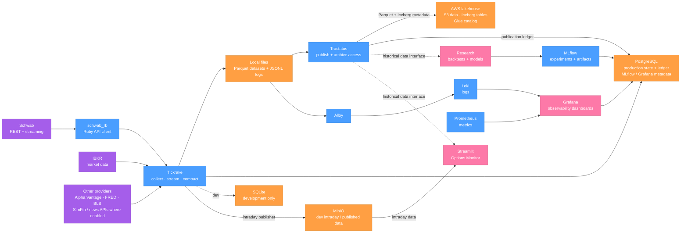

# Quant Platform Architecture

Tickrake collects market and reference data, writes local Parquet datasets, and maintains collection/runtime state. Tractatus publishes eligible datasets to an AWS S3 lakehouse registered in Glue and managed with Iceberg, keeping a PostgreSQL ledger of publication state. Research and trading-support consumers read historical data through Tractatus. PostgreSQL is the active transactional backend in production; SQLite remains the Tickrake development default and is not the production datastore.

## Notes

- Production Tickrake uses PostgreSQL. SQLite remains configured for the isolated
  development profile; the production SQLite database was imported during the
  PostgreSQL cutover and is no longer the active backend.
- Tickrake's local Parquet store is the publisher's input. Tractatus records
  publication state in PostgreSQL and publishes data to S3 with Iceberg table
  metadata in Glue. S3 is the durable historical lakehouse, not the Tractatus
  ledger.
- Each source is independent: Schwab connects to Tickrake through the
  `schwab_rb` gem; IBKR and other provider adapters connect separately. Tickrake
  jobs also collect fundamentals, economic events, earnings, and other
  reference data. Alpha Vantage, FRED/BLS, and SimFin availability depends on
  the configured job/provider. News APIs are not shown as an active Tickrake
  feed unless a job is configured for one.
- Tickrake has multiple output paths: local Parquet files feed the Tractatus
  catalog publisher, and the intraday publisher writes to MinIO. Tractatus
  publishes eligible local files to the AWS Iceberg lakehouse; Tickrake does
  not publish directly to that lakehouse.
- Alloy ships Tickrake and Tractatus JSONL log files to Loki. Prometheus scrapes
  infrastructure metrics, including Docker service health and host container
  statistics. Grafana dashboards query both.
- MLflow stores experiment metadata in PostgreSQL and artifacts in its
  persistent artifact volume. Tickrake and Tractatus logs and scraped datasets
  use local mounted filesystems before publication or log shipping.
- The Streamlit Options Monitor is currently enabled in the development
  profile and reads the MinIO intraday bucket. Historical access through
  Tractatus is the intended interface represented here; deployment-specific
  wiring should be verified before treating it as active production behavior.
