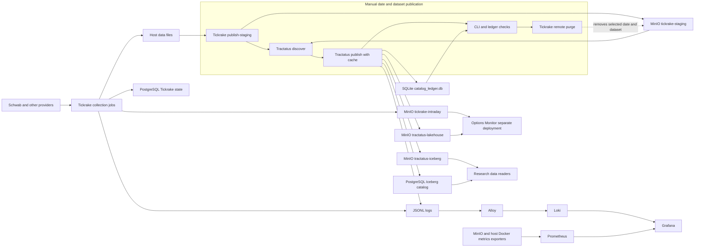

# Quant Platform Architecture Diagram

The current production stack collects with Tickrake and publishes selected
dates manually through a short-lived Tickrake/Tractatus container. The
historical lakehouse is local: MinIO stores Iceberg data and PostgreSQL is
the Iceberg SQL catalog. Tractatus keeps publication state in a separate
SQLite ledger.

`make prod-up` runs collection, storage, and monitoring. It does not start
Options Monitor, MLflow, or a scheduled lakehouse publisher. The manual
publication container joins the production Docker network and keeps local
Tickrake source files after remote staging is purged. The [setup guide](SETUP.md)
and [publication runbook](notes/one-off-daily-publication.md) have the current
commands and safety checks.
