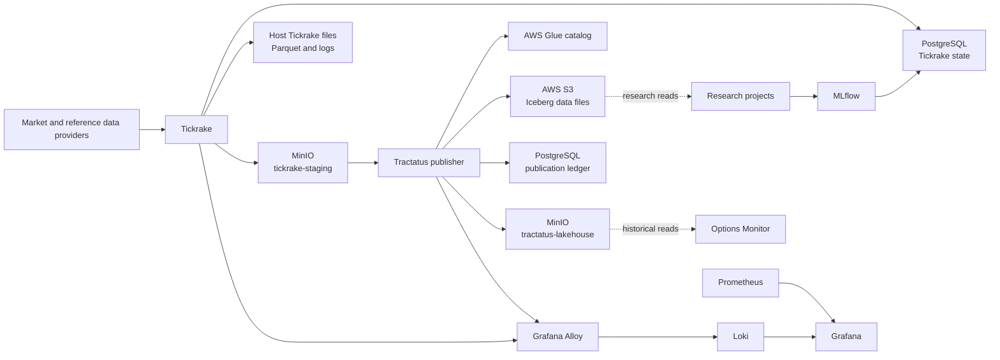

# Platform Architecture

`quant-infra` runs the local research platform and its data collection
services with Docker Compose. Tickrake owns collection and operational state;
Tractatus publishes completed data into the historical lakehouse; research
projects consume published datasets and use MLflow to track experiments.

## Data path

AWS S3 with Iceberg metadata in Glue is the durable historical lakehouse.
MinIO holds Tickrake staging objects and a local Tractatus cache; it is not a
second authoritative catalog. The Tractatus PostgreSQL ledger records
publication work separately from both Glue state and object storage. Check
each layer independently when investigating a publish.

Tickrake runs collection jobs from versioned configuration in this repository
and keeps production metadata in PostgreSQL. Development retains an isolated
SQLite-backed Tickrake home. Its staging publisher uploads supported completed
files to `tickrake-staging`; the Tractatus publisher reads that bucket, appends
normalized records through the Glue-backed Iceberg catalog, updates its
ledger, and writes its local cache to `tractatus-lakehouse`.

The Tickrake staging job and Tractatus scheduler run at 16:05 and 16:15
America/Chicago on weekdays, respectively. A known gap remains: Tickrake's
streaming pending-events spool under `~/.tickrake/staging/pending_events` is
not scanned by the current staging publisher. Successful stream writes do not
prove those files were staged. See
[`docs/notes/tickrake_streaming_staging_path.md`](notes/tickrake_streaming_staging_path.md).

## Runtime and observability

The Makefile assembles service Compose files with an environment overlay. The
current checkout exposes production, research, and data-ingestion profiles;
research and data-ingestion use the production Compose project. The research
profile starts PostgreSQL and MLflow; data-ingestion runs production
collection with PostgreSQL, MinIO, and collection observability; the
production profile runs the full stack. The Options Monitor service is marked
`dev` only, but the current checkout has no dev overlay or dev Makefile
targets. See [the setup guide](SETUP.md) for commands and ports.

Alloy ships Tickrake and Tractatus JSONL logs to Loki. Prometheus scrapes
service and host Docker metrics, and Grafana presents logs and metrics. The
Options Monitor currently runs only in the development profile and reads
MinIO intraday and historical buckets. MLflow stores experiment metadata in
PostgreSQL and artifacts in its persistent volume.

## Service boundaries

- **Tickrake:** provider integrations, collection jobs, local data files, and
  collection state.
- **Tractatus:** normalization and publication through Glue/Iceberg, a
  PostgreSQL publication ledger, and the MinIO cache.
- **quant-infra:** Compose runtime, configuration, credentials wiring,
  observability, and operational procedures.
- **Research projects:** analysis and backtests over published datasets;
  MLflow tracks experiments.

See [the ADR index](adr/README.md) for durable platform decisions and
[`docs/notes/`](notes/README.md) for operational evidence and unresolved
findings.
