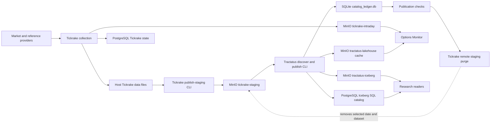

# Platform Architecture

`quant-infra` is the local Compose runtime for market-data collection,
storage, and observability. Tickrake collects data and owns the
`tickrake-staging` handoff bucket. Tractatus consumes staged files, writes the
local Iceberg lakehouse, and maintains a separate cache for readers.

## Data path

The one-off runner in `services/publish-lakehouse/` starts a short-lived
container with Tickrake and Tractatus CLIs built from their remote `main`
branches. For one dataset and sample date, it stages with `--no-delete`,
discovers and publishes with cache, checks CLI counts and committed/cached
ledger state, then purges **remote staging only**. Local Tickrake files remain.
This is a manual workflow with no production schedule. Count and ledger
checks do not establish a file-by-file identity match; a failed purge may
partly delete staging objects. See the [publication runbook](notes/one-off-daily-publication.md).

The local Iceberg catalog lives in the `tractatus` PostgreSQL database.
Iceberg data and metadata live in the MinIO `tractatus-iceberg` bucket. The
publication ledger is a separate SQLite file at
`~/.tractatus/catalog_ledger.db`; `tractatus-lakehouse` is a cache, not the
Iceberg warehouse. Check catalog state, object presence, ledger rows, and
cache contents separately when investigating publication.

## Runtime and observability

The Makefile assembles the production service definitions and
`deploy/prod.yml` under the `quant-infra-prod` project. `make prod-up` starts
PostgreSQL, MinIO, Tickrake collection, Grafana, Prometheus, Loki, Alloy, and
the MinIO storage metrics exporter. MLflow, Options Monitor, the scheduled
Tickrake staging job, and a scheduled Tractatus publisher are not part of the
active production service set. See [setup](SETUP.md) for commands and ports.

Tickrake JSONL logs and Tractatus catalog logs are mounted into Alloy and
shipped to Loki. Prometheus scrapes the MinIO storage metrics exporter and
the separate host Docker stats exporter; Grafana reads Loki and Prometheus.
Options Monitor has its own Compose definition and can consume the MinIO
intraday and cache buckets, but is not started by `make prod-up`.

## Ownership

- **Tickrake:** provider connections, collection jobs, local source files,
  PostgreSQL collection state, the staging bucket, and its remote purge.
- **Tractatus:** staged-file discovery, normalization, local Iceberg commits,
  publication ledger, and lakehouse cache.
- **quant-infra:** Compose configuration, one-off container wiring,
  environment files, monitoring, and operational runbooks.
- **Consumers:** research and monitoring applications reading published data
  through their configured interfaces.

See the [architecture diagram](architecture-diagram.md) for a compact view and
the [notes index](notes/README.md) for operational evidence. Some older ADRs
record earlier deployment choices; verify their status against this runtime
configuration before using them as current setup instructions.
